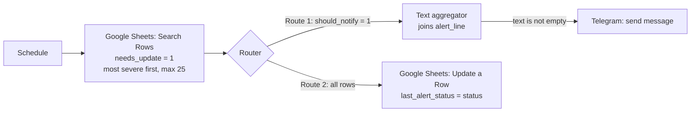

# Inventory Alerts Automation (Make)

The same inventory-alert automation as the [n8n version](../inventory-alerts-n8n/README.md), rebuilt for **Make** with a different architecture: the decision logic lives in **spreadsheet formulas**, and the Make scenario only moves data around. It watches a retail inventory sheet and sends **one grouped alert** to Telegram when products run low.

- **No alert spam.** A product that stays low does not alert again every run; only a *worsening* status does.
- **Bad data is never swallowed.** Blank or non-numeric stock is reported as a data issue instead of being treated as zero.
- **Cheap to run.** The scenario fetches only rows whose status *changed*. If nothing changed, a run executes a single search module and stops, which matters on plans billed per operation.
- **The formulas are verified** against a reference implementation across 1,008 input combinations (see [Verification](#verification)).

## How it works



1. A scheduled run searches the sheet for rows where `needs_update = 1`. Those are rows whose computed `status` differs from what was last recorded.
2. **Route 1** keeps the rows that got *worse* (`should_notify = 1`), joins their ready-made `alert_line` texts into a single message, and sends it to Telegram.
3. **Route 2** writes the new `status` into `last_alert_status` for every fetched row, so the same situation is not reported again. Recoveries and improvements are recorded silently.

## Where the logic lives

The sheet has seven **input columns (A-G)** and eleven **formula columns (H-R)**. Make writes only column G.

| Column | Purpose |
|---|---|
| `stock_num`, `reorder_num` | Numbers parsed from the raw cells (`""` if blank or text) |
| `status` | `OUT` / `CRITICAL` / `LOW` / `OK` / `DATA_ERROR` |
| `issue` | Why a row is a `DATA_ERROR` |
| `severity`, `previous_severity` | 0-3 ranking of the current and the last recorded status |
| `previous_status` | `last_alert_status`, normalised (blank = `OK`) |
| `should_notify` | `1` only if severity increased, or a new data error appeared |
| `needs_update` | `1` if `last_alert_status` must be rewritten |
| `sort_priority` | Orders the alert, most severe first |
| `alert_line` | The text line sent to Telegram |

Rules, thresholds and the full notify/update behaviour are the same as in the [n8n project](../inventory-alerts-n8n/README.md#alert-rules): `OUT` = stock 0, `CRITICAL` = stock ≤ 50% of the reorder point, `LOW` = stock ≤ reorder point.

## Setup

1. **Sheet:** run `python scripts/build_template.py` (or use `data/inventory_make_template.xlsx` as it is) and import the file into Google Sheets. Keep the first sheet named `inventory` and keep the header names exactly.
2. **Telegram bot:** create one with [@BotFather](https://t.me/BotFather), keep the token, send the bot a message and find your chat ID.
3. **Make:** create a scenario with the modules below and add the Google Sheets and Telegram connections **inside Make**. Option labels can differ slightly between Make versions.

| Module | Key settings |
|---|---|
| Scheduling | Interval of your choice (check your plan's minimum interval) |
| **Google Sheets: Search Rows** | Sheet `inventory`; filter `needs_update` numeric *equal to* `1`; sort by `sort_priority`, descending; maximum rows `25` |
| **Router** | Two routes. Keep the **notification route first** |
| Route 1 filter | `should_notify` numeric *equal to* `1` |
| **Tools: Text aggregator** | Source module: Search Rows; text: `alert_line`; row separator: new row |
| Filter before Telegram | aggregated text *exists / is not empty* (required, see note) |
| **Telegram Bot: Send a Text Message** | Chat ID; text: `📦 Inventory alert`, a line break, then the aggregated text |
| Route 2: **Google Sheets: Update a Row** | Row number from Search Rows; set `last_alert_status` to `status` |

**Why write `status` even when it is `OK`?** Writing an empty value is not reliable in every module, and the formulas already treat blank and `OK` as the same state, so `OK` is written explicitly.

**Why the "text is not empty" filter?** A run can contain only silent updates (for example a product that recovered). In that case there is nothing to send, and an empty Telegram message would raise an error and block the update route.

**Failure handling:** enable *Allow storing of incomplete executions* in the scenario settings and add a **Break** error handler to the Telegram module. If sending fails, the sheet is not updated, and the alert is retried on the next run instead of being lost.

**Limits:** at most 25 rows are processed per run (a message of 25 typical lines stays well under Telegram's 4,096-character limit). Rows beyond that stay unprocessed and are picked up in the next run, most severe first.

## Verification

The alert logic exists twice in this portfolio: as JavaScript in the n8n project (with its own unit tests) and as the formulas in this sheet. `scripts/verify_against_n8n.py` runs about 1,000 input combinations through **both** (numbers stored as text, blanks, negatives, padded spaces, every previous status) and fails on any difference.

```bash
python scripts/verify_against_n8n.py   # needs LibreOffice (soffice) and Node.js on the PATH
```

Result: `Compared 1008 input combinations / OK: spreadsheet formulas and the JavaScript reference agree on every case`. The verifier was itself checked by injecting a deliberate bug (a wrong threshold), which it detected.

The Make scenario itself is exercised with the checklist in [`docs/test_plan.md`](docs/test_plan.md).

## Design decisions and limitations

- **Formulas instead of code.** Business rules are visible and editable by non-programmers, no code module is needed, and Make only fetches changed rows. The cost: logic spread across cells is harder to unit test (hence the cross-check against the JavaScript version) and anyone editing a formula column can break it.
- **The sheet is the state store.** Simple and transparent, but Google Sheets is not a database; at high volume a real database is a better fit.
- **Polling, not events.** The scenario checks on a schedule; it does not react the moment stock changes.
- **Numbers are parsed with `VALUE()`**, which follows the spreadsheet's locale: a decimal such as `12,5` or `12.5` depends on the sheet's regional settings. The sample data uses whole numbers.
- **Thresholds are fixed per product.** They ignore demand and supplier lead time; alerting on estimated days of cover is a natural next step.

## Project structure

```
inventory-alerts-make/
├── data/
│   ├── inventory_sample.csv           # fictional inventory (includes bad rows)
│   └── inventory_make_template.xlsx   # import into Google Sheets
├── scripts/
│   ├── build_template.py              # generates the template (inputs + formula columns)
│   └── verify_against_n8n.py          # cross-checks the formulas
├── docs/
│   ├── test_plan.md                   # scenario test checklist
│   └── screenshots/                   # screenshots of the scenario in Make
└── README.md
```

<!-- After building the scenario in Make, add a screenshot to docs/screenshots/ and show it here:

-->
